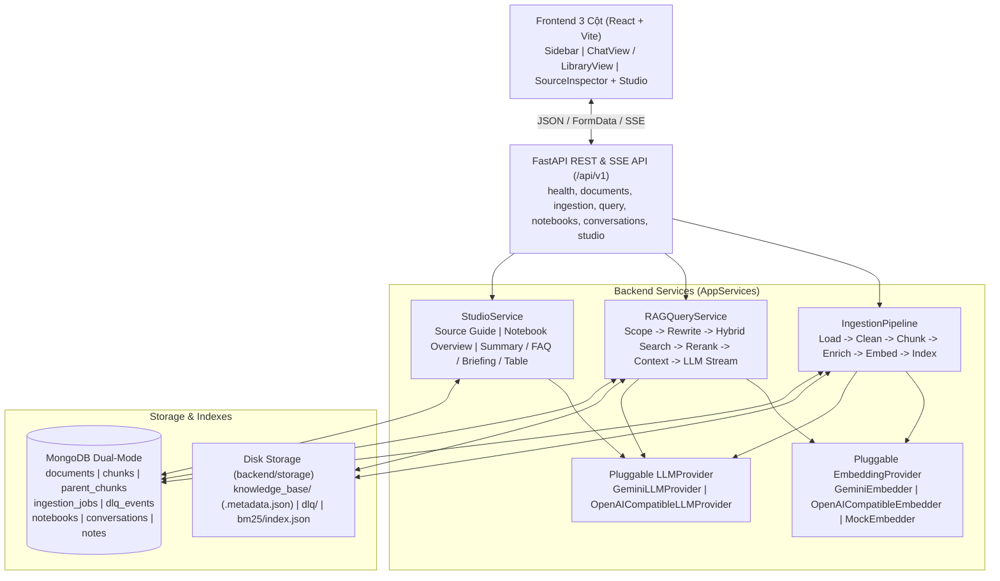
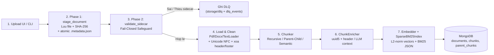
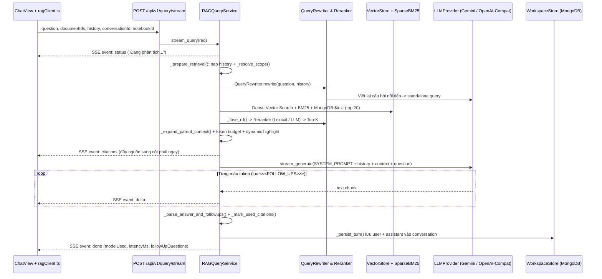

# Giải thích Chi tiết Kỹ thuật & Luồng hoạt động Dự án (Enterprise RAG — NotebookLM Edition)

Tài liệu này giải thích rõ ràng kiến trúc, vai trò từng module và **diễn biến chi tiết từng bước theo đúng thứ tự luồng chạy thực tế** của dự án, từ lúc khởi động server đến khi nạp tài liệu, truy vấn AI streaming và làm việc trong không gian NotebookLM.

---

## 1. Tổng quan Kiến trúc & Bản đồ Mã nguồn

Hệ thống được thiết kế theo kiến trúc tách lớp rõ ràng gồm **Frontend (React + TypeScript)**, **FastAPI API Layer**, **AI & Retrieval Orchestration**, **Ingestion Pipeline**, và **MongoDB Storage**.

### Bản đồ thư mục chính

| Thành phần | Đường dẫn | Trách nhiệm chính |
| :--- | :--- | :--- |
| **Cấu hình & Env** | `backend/src/config/settings.py` | Nạp biến `.env`, tách cấu hình LLM & Embedding, ánh xạ danh mục sang `department` |
| **Khởi tạo App** | `backend/src/main.py`, `backend/src/api/deps.py` | Khởi tạo toàn bộ service (`AppServices`), CORS và gắn 7 nhóm router `/api/v1` |
| **AI Model API** | `backend/src/llm/` | Giao diện chung `LLMProvider`, adapter Gemini (`google-genai`) & OpenAI-Compatible (`httpx`) |
| **Ingestion** | `backend/src/ingestion/` | Loaders (`PDF/DOCX/MD/TXT`), `TextCleaner`, 3 loại Chunkers, `ChunkEnricher`, Embedders, `SparseBM25Index` |
| **Retrieval & Studio** | `backend/src/retrieval/` | `RAGQueryService`, `QueryRewriter`, `Reranker`, `StudioService` |
| **Storage & Vector DB** | `backend/src/storage/`, `backend/src/vectordb/` | `KnowledgeBaseStore` (Two-Phase + DLQ), `WorkspaceStore`, `MongoDBVectorStore` Dual-Mode, `InMemoryVectorStore` |
| **Schemas** | `backend/src/schemas/` | Hợp đồng Pydantic v2 (code Python dùng `snake_case`, JSON API tự serialize sang `camelCase`) |
| **Frontend UI** | `frontend/src/` | `App.tsx`, `api/ragClient.ts`, `utils/markdown.tsx`, `Sidebar.tsx`, `ChatView.tsx`, `SourceInspector.tsx`, `StudioPanel.tsx`, `SourceGuideModal.tsx`, `LibraryView.tsx` |

---

## 2. Luồng 0 — Khởi động Hệ thống & Kết nối Service

Trước khi xử lý bất kỳ yêu cầu nào từ người dùng, hệ thống thực hiện chuỗi khởi tạo theo thứ tự sau:

### 2.1. Phía Backend (`backend/src/main.py`)
1. **Nạp cấu hình (`Settings`):** Đọc file `.env` ở thư mục gốc trước, sau đó ghi đè bằng `backend/.env`. Các thuộc tính `resolved_llm_api_key`, `resolved_llm_model`, `resolved_embedding_api_key`, `resolved_embedding_model` giúp tự suy ra cấu hình hợp lệ mà không phụ thuộc chéo giữa LLM và Embedding.
2. **Khởi tạo `create_app()` & `lifespan`:** Khi Uvicorn khởi động, hàm `build_services()` chạy một lần duy nhất:
   - **`KnowledgeBaseStore`:** Chuẩn bị 2 thư mục `storage/knowledge_base/` và `storage/dlq/`.
   - **`MongoDBVectorStore.ensure_indexes()`:** Tạo index cho 5 collection RAG (`documents`, `parent_chunks`, `chunks`, `ingestion_jobs`, `dlq_events`). Nếu `MONGODB_VECTOR_MODE=auto`, hàm tự dò thử `list_search_indexes()` của Atlas Search; nếu gặp MongoDB Community (trả `OperationFailure`), hệ thống êm ái chuyển `active_vector_mode = "community"`.
   - **`WorkspaceStore.ensure_indexes()`:** Tự chọn `MongoWorkspaceStore(store.db)` (nếu chạy MongoDB) hoặc `InMemoryWorkspaceStore()` (nếu chạy test in-memory) cho 3 collection NotebookLM (`notebooks`, `conversations`, `notes`).
   - **`build_embedder(settings)` & `build_llm_provider(settings)`:** Khởi tạo độc lập 2 provider dựa trên `EMBEDDING_PROVIDER` và `LLM_PROVIDER`.
   - **`SparseBM25Index`:** Nạp file chỉ mục từ khóa `storage/bm25/index.json` vào RAM.
   - Đóng gói tất cả vào `AppServices` lưu trên `app.state.services` để mọi route nhận qua `Depends(get_services)`.

### 2.2. Phía Frontend (`frontend/src/App.tsx`)
Ngay khi trình duyệt mở trang (`useEffect` lúc mount), `loadBackendState()` gọi song song `Promise.allSettled`:
- `GET /api/v1/health` → cập nhật `connectionState`, tên model LLM/Embedding và chế độ Vector DB ở chân Sidebar.
- `GET /api/v1/documents` → nạp danh sách tài liệu.
- `GET /api/v1/notebooks` → nạp danh sách Notebooks.
- `GET /api/v1/conversations` & `GET /api/v1/notes` → nạp lịch sử hỏi đáp và ghi chú Studio của Notebook đang chọn.

---

## 3. Luồng 1 — Nạp Tài liệu (Offline Data Ingestion Pipeline)

Đây là luồng chuyển đổi một tệp thô (`.pdf`, `.docx`, `.md`, `.txt`) thành dữ liệu tìm kiếm đa tầng (Dense Vector + Sparse BM25 + Metadata phân quyền).

### Thứ tự thực thi chi tiết (Bước 1 → Bước 7)

1. **Tiếp nhận đầu vào (`documents.py` → `IngestionPipeline.ingest_uploaded_file`):**
   - Người dùng kéo thả file ở `LibraryView.tsx` (kèm danh mục `"Nhân sự"`, `"Vận hành"`, `"Kỹ thuật & IT"`) hoặc chạy CLI `ingest`.
   - `category_to_department()` chuẩn hóa danh mục sang mã phòng ban ổn định (`dept-hr`, `dept-ops`, `dept-it`, hoặc tự tạo slug không dấu `dept-...` nếu có danh mục mới).
2. **Phase 1 — Staging & Ghi Sidecar (`KnowledgeBaseStore.stage_document`):**
   - Kiểm tra phần mở rộng hợp lệ và giới hạn `MAX_FILE_SIZE_MB`.
   - Tính mã băm `SHA-256` của nội dung file.
   - Lưu file gốc vào `storage/knowledge_base/{tenant_id}/{department}/{doc_id}/{safe_filename}`.
   - Ghi tệp `<filename>.metadata.json` bằng **atomic write** (ghi file `.tmp` rồi `replace()`) chứa `tenant_id`, `department`, `access_groups`, `document_id`, `content_hash`, `version`.
3. **Phase 2 — Sidecar Safeguard (`validate_sidecar` — Nguyên tắc Fail-Closed):**
   - Trước khi trích xuất nội dung, `ingest_from_kb_path()` bắt buộc xác thực file `.metadata.json` tồn tại, đúng schema `MetadataSidecar`, và `tenant_id`/`department` trong JSON khớp với thư mục vật lý.
   - Nếu sai lệch hoặc thiếu sidecar (tránh lỗi race condition / file chép lậu chưa gắn nhãn quyền), pipeline **ngắt ngay**, ghi sự cố vào `storage/dlq/` và collection `dlq_events`.
   - Kiểm tra idempotent: khi chạy `sync` (`force=False`), nếu `document_id` đã `ready` và `content_hash` không đổi thì bỏ qua để không tốn chi phí embed lại.
4. **Trích xuất & Làm sạch (`loaders/` + `TextCleaner`):**
   - `PdfLoader`: dùng `pymupdf` (fallback `pypdf`), đọc từng trang và bắt regex tiêu đề mục (`I.`, `1.2.`, `Chương`...) để giữ ngữ cảnh `section`.
   - `DocxLoader`: duyệt `doc.element.body.iterchildren()` theo đúng thứ tự xuất hiện giữa đoạn văn và bảng (`CT_Tbl`), chuyển bảng thành Markdown chuẩn (`| cột | ... |`) để không làm vỡ cấu trúc dữ liệu bảng khi cắt chunk.
   - `TextLoader`: tách file `.md` theo heading `#`..`######` (bỏ qua `#` nằm trong block code).
   - `TextCleaner`: chuẩn hóa tiếng Việt về **Unicode NFC** (khắc phục lỗi dấu rời NFD từ PDF), nối từ bị gạch ngang ngắt dòng, xóa ký tự ẩn, và tự nhận diện xóa header/footer lặp lại ở `>= 60%` số trang PDF.
5. **Cắt đoạn văn bản (`chunkers/`):**
   - `RecursiveChunker` *(mặc định)*: tách đệ quy theo dấu xuống đoạn → dòng → câu → dấu phẩy, giữ ngưỡng token (`400` tokens) và gối đầu `80` tokens.
   - `ParentChildChunker` *(Small-to-Big)*: cắt trang thành `ParentChunk` lớn (`1000` tokens) lưu ở collection `parent_chunks`, rồi cắt tiếp mỗi Parent thành các `ChildChunk` nhỏ (`250` tokens) gắn `parent_id` để embed.
   - `SemanticChunker`: embed từng câu, đo tích vô hướng giữa các câu kề nhau và ngắt chunk tại các điểm tụt độ tương đồng (phân vị 20%).
6. **Làm giàu ngữ cảnh (`ChunkEnricher`):**
   - Sinh `chunk.id` xác định bằng `uuid5(NAMESPACE_URL, f"{document_id}:{content_hash}:{chunk_index}")` để re-ingest không tạo bản sao rác.
   - Tạo `contextual_content` dùng riêng cho embedding (trong khi giữ `content` sạch để hiển thị cho người dùng):
     - `header`: ghép tiền tố `[Tài liệu: ... | Danh mục: ... | Phòng ban: ... | Mục: ... | Trang: ...]`.
     - `llm`: gọi `GEMINI_CONTEXT_MODEL` viết 1–2 câu tóm tắt vai trò đoạn trích trong tài liệu (tự fallback về `header` nếu lỗi).
7. **Tạo Vector, BM25 & Lưu trữ đồng bộ (`pipeline.py`):**
   - Gọi `embedder.embed_texts(..., task_type="RETRIEVAL_DOCUMENT")` theo batch 50 chunks, tất cả vector được `l2_normalize()` để độ dài bằng `1.0` (tích vô hướng = Cosine Similarity).
   - Gọi `vector_store.replace_document_chunks()` xóa sạch chunk/parent cũ của `document_id` rồi chèn bộ mới vào MongoDB.
   - Gọi `bm25_index.upsert_document_chunks()` tách song song từ tiếng Việt **có dấu + không dấu** và giữ nguyên mã kỹ thuật (`Sev-1`, `503`), lưu xuống `storage/bm25/index.json`.
   - Cuối cùng cập nhật `status="ready"` kèm `chunk_count`.

---

## 4. Luồng 2 — Hỏi đáp AI & Streaming Trích dẫn (Online RAG Query Pipeline)

Đây là luồng cốt lõi khi người dùng đặt câu hỏi trên giao diện `ChatView.tsx` hoặc gọi API `/api/v1/query` / `/api/v1/query/stream`.

### Diễn giải chi tiết 9 bước xử lý (Bước 1 → Bước 9)

1. **Gửi yêu cầu & Khởi tạo phiên hội thoại (`App.tsx` → `ragClient.ts`):**
   - `App.tsx` thu thập danh sách `documentIds` đang bật (hoặc thuộc Notebook đang chọn), lấy tối đa 6 lượt `history` gần nhất. Nếu chưa có `conversationId`, gọi `POST /api/v1/conversations` để tạo cuộc hội thoại mới trên MongoDB.
   - `streamQueryRag()` gửi `POST /api/v1/query/stream` và đọc luồng SSE qua `ReadableStream` + `TextDecoder`.
2. **Xác thực phạm vi truy xuất (`_resolve_scope` — Fail-Closed):**
   - Phát event `status` (`analyzing`).
   - Nếu `documentIds` rỗng `[]` → trả ngay `EMPTY_SCOPE_ANSWER`.
   - Ngược lại, chỉ lọc các tài liệu có `enabled=True` và `status="ready"`, dựng `SearchFilter(tenant_id, departments, document_ids, only_enabled=True)`. Điều này đảm bảo tài liệu bị tắt hoặc thuộc phòng ban khác không bao giờ bị tìm thấy.
3. **Viết lại câu hỏi đa lượt (`QueryRewriter.rewrite`):**
   - Nếu câu hỏi có `history` (ví dụ lượt 1 hỏi *"Nhân viên được mấy ngày phép?"*, lượt 2 hỏi *"Thế còn chuyển sang năm sau?"*), `QueryRewriter` gọi LLM với `temperature=0.0` viết lại thành câu truy vấn độc lập: *"Điều kiện chuyển ngày phép năm sang năm sau là gì?"*.
   - Nếu không có lịch sử hoặc LLM chưa cấu hình/lỗi, giữ nguyên câu hỏi gốc.
4. **Tìm kiếm Lai (`Hybrid Search`: Dense + Sparse):**
   - **Dense Vector Search:** Embed `search_query` với `task_type="RETRIEVAL_QUERY"`, gọi `vector_store.vector_search(..., top_k=candidate_k)` (mặc định `20` ứng viên). Ở chế độ `community`, MongoDB lọc trước bằng `idx_isolation_prefilter` rồi nhân ma trận NumPy `mat @ q`; ở chế độ `atlas`, chạy `$vectorSearch`.
   - **Sparse Keyword Search:** Chạy `bm25_index.search()` (BM25Okapi với token tiếng Việt có dấu + không dấu) song song với fallback `vector_store.keyword_search()` (MongoDB `$text`).
   - Nếu một chunk chỉ xuất hiện ở BM25 mà chưa có trong kết quả vector, `_resolve_missing_chunks()` tự nạp bổ sung chunk từ store.
5. **Trộn thứ hạng RRF (`_fuse_rrf`):**
   - Hợp nhất danh sách xếp hạng Dense và Sparse bằng công thức Reciprocal Rank Fusion:
     $$\text{RRF}(d) = \frac{1}{60 + \text{rank}_{\text{dense}}(d)} + \frac{1}{60 + \text{rank}_{\text{sparse}}(d)}$$
   - Đoạn văn vừa khớp ngữ nghĩa (Dense) vừa khớp đúng từ khóa/mã hiệu kỹ thuật (BM25) sẽ vọt lên đầu bảng.
6. **Xếp hạng lại & Lọc ngữ cảnh (`Reranker` + `Small-to-Big` + `Dynamic Highlight`):**
   - `LexicalOverlapReranker` *(mặc định)* kết hợp điểm RRF, độ tương đồng Dense, tỷ lệ trùng từ khóa trong nội dung/tiêu đề mục và thưởng khớp cụm từ để chọn ra `top_k` (mặc định `6`) đoạn tốt nhất. (Có thể bật `RERANKER_PROVIDER=llm` để AI chấm điểm 0–10 từng đoạn).
   - `_expand_parent_context()`: nếu chunk có `parent_id`, lấy toàn bộ `ParentChunk` (`1000` tokens) đưa vào ngữ cảnh LLM (trong khi vẫn giữ đoạn con `content` và trường `parentContent` riêng để UI cho phép bấm "Mở rộng ngữ cảnh").
   - Áp dụng ngân sách `context_max_tokens` (`6000` tokens) để không vượt quá giới hạn cửa sổ ngữ cảnh của model.
   - `_extract_query_highlight()`: tìm đúng câu trong chunk trùng nhiều từ khóa truy vấn nhất để tô sáng ở cột phải, thay vì cắt cứng 120 ký tự đầu.
   - Đẩy ngay event SSE `citations` về Frontend để cột phải hiển thị danh sách nguồn trước khi AI trả lời xong.
7. **Sinh câu trả lời bám nguồn & Streaming (`LLMProvider.stream_generate`):**
   - Lắp ghép `SYSTEM_PROMPT` (yêu cầu trả lời Markdown tiếng Việt, gắn `[1]`, `[2]...`, không suy diễn ngoài ngữ cảnh, và xuất 3 câu hỏi gợi ý sau dòng phân tách `<<<FOLLOW_UPS>>>`) + tối đa 6 lượt `history` + `context_blocks` + `question`.
   - Khi stream qua `GeminiLLMProvider` hoặc `OpenAICompatibleLLMProvider`, `stream_query()` giữ một bộ đệm đuôi (`guard_len`) để phát từng mảnh text qua event `delta` nhưng **chặn sạch dấu phân tách `<<<FOLLOW_UPS>>>`** không bị lọt ra màn hình chat.
   - **Cơ chế Fallback minh bạch:** Nếu chưa cấu hình API key hoặc API lỗi/hết quota, hệ thống dùng `_build_extractive_fallback()` và gắn rõ `generationMode="extractive_fallback"` kèm thông báo `warning` để người dùng biết ngay trên giao diện.
8. **Hậu xử lý trích dẫn & Lưu hội thoại (`_mark_used_citations`, `_persist_turn`):**
   - Quét regex `\[\d+\]` trong câu trả lời hoàn chỉnh để gán `usedInAnswer=True/False` cho từng nguồn (nguồn không được nhắc trực tiếp sẽ gắn nhãn `Tham khảo thêm`).
   - Lưu cặp tin nhắn `user` + `assistant` (kèm `citations`, `modelUsed`, `followUpQuestions`) vào `WorkspaceStore` (collection `conversations`) và tự đặt tên cuộc hội thoại theo câu hỏi đầu tiên.
   - Phát event cuối `done` để Frontend hoàn tất trạng thái streaming và hiện 3 chip **Câu hỏi tiếp theo gợi ý**.
9. **Hiển thị tương tác ở Frontend (`markdown.tsx` + `SourceInspector.tsx`):**
   - `renderMarkdown()` chuyển đổi heading, danh sách, bảng GFM, block code và biến mỗi `[1]`, `[2]` thành chip tương tác: **di chuột** hiện tooltip trích đoạn nguồn, **bấm vào** mở và cuộn thẳng tới đoạn nguyên văn tương ứng ở cột phải.

---

## 5. Luồng 3 — Không gian làm việc NotebookLM (`Notebooks`, `Source Guide`, `Studio & Ghi chú`)

1. **Notebooks (`notebooks.py`, `Sidebar.tsx`):**
   - Cho phép tạo nhiều Notebook độc lập, mỗi Notebook lưu danh sách `documentIds` riêng, bản `overview` và `suggestedQuestions`.
   - Khi bật một Notebook, mọi thao tác tick nguồn ở cột trái, lịch sử hội thoại, ghi chú Studio và câu hỏi gửi lên `query` đều tự động khoanh vùng theo đúng Notebook đó.
2. **Source Guide (`GET /api/v1/documents/{id}/guide`, `SourceGuideModal.tsx`):**
   - Bấm biểu tượng `(i)` bên cạnh bất kỳ tài liệu nào ở Sidebar hoặc nút **"Xem Source Guide"** trong thẻ trích dẫn.
   - Backend (`StudioService.generate_source_guide`) lấy mẫu rải đều tối đa 10 chunks của tài liệu, gọi LLM trả JSON gồm `summary`, `keyTopics`, `suggestedQuestions`, kết hợp với API `GET /documents/{id}/chunks` để người dùng đọc lướt toàn bộ nội dung đã cắt đoạn và bấm hỏi ngay một câu hỏi gợi ý.
3. **Tổng quan & Studio (`POST /api/v1/notebooks/overview`, `POST /api/v1/studio/generate`, `StudioPanel.tsx`):**
   - **Tổng quan AI:** Tổng hợp bức tranh chung của tập tài liệu đang bật kèm 4 câu hỏi khởi đầu thay cho câu hỏi mẫu tĩnh.
   - **Studio 1-click:** Thu thập đại diện các đoạn văn bản từ các nguồn đang chọn trong ngân sách `context_max_tokens`, gọi LLM sinh theo 5 mẫu chuyên biệt (`Tóm tắt`, `FAQ`, `Briefing Doc`, `Ôn tập`, `Bảng đối chiếu`) kèm mã nguồn `[1]`, `[2]...`, và tự lưu thành `NoteItem` trong collection `notes`.
   - **Ghim ghi chú (Pin):** Dưới mỗi câu trả lời trong Chat có nút **Ghim ghi chú** để lưu ngay câu trả lời đó vào tab **Studio** bên phải.

---

## 6. Bảo mật, Cô lập Dữ liệu & Chiến lược Kiểm thử

### 6.1. Bảo mật & Cô lập dữ liệu
- **Fail-Closed ở tầng truy vấn:** `is_filter_authorized()` trong `backend/src/vectordb/base.py` từ chối trả về dữ liệu (`[]`) nếu `SearchFilter` thiếu `tenant_id` hoặc rỗng cả `departments` lẫn `access_groups`.
- **Fail-Closed ở tầng nạp dữ liệu:** Thiếu `.metadata.json` hoặc sai lệch `department` giữa thư mục và sidecar sẽ bị chặn và đẩy vào Dead-Letter Queue (`dlq_events`).
- **Tách biệt phạm vi tức thì:** Khi bật/tắt `enabled` trên 1 tài liệu (`PATCH /api/v1/documents/{id}`), trạng thái được cập nhật đồng bộ ở cả collection `documents`, mọi chunk trong `chunks` và chỉ mục `SparseBM25Index`.

### 6.2. Bộ kiểm thử & Đánh giá (`backend/tests/` & `backend/scripts/eval_rag.py`)
Toàn bộ 19 test cases sử dụng `InMemoryVectorStore`, `InMemoryWorkspaceStore` và `httpx.MockTransport` để kiểm thử nhanh, không phụ thuộc mạng hay MongoDB thật:
- `test_kb_sidecar_safeguard.py`: kiểm tra Phase 1/Phase 2 sidecar safeguard, chặn file thiếu/lệch sidecar vào DLQ, idempotent `sync`.
- `test_loaders_and_cleaner.py`: chuẩn hóa tiếng Việt NFC, lọc header/footer PDF, chuyển bảng DOCX thành Markdown, đọc file PDF/DOCX thực tế.
- `test_chunkers.py`: kiểm tra `RecursiveChunker`, `ParentChildChunker` và `SemanticChunker`.
- `test_enricher_and_isolation.py`: cô lập `dept-hr` vs `dept-it`, fail-closed filter, ẩn khi `enabled=False`, xóa sạch dữ liệu và tiền tố Contextual Retrieval.
- `test_api_and_e2e.py`: vòng đời chuẩn `/health`, `/documents/upload`, `/documents`, `/chunks`, `/query`, `PATCH`, `/ingestion/sync`, `DELETE`.
- `test_llm_providers_and_streaming.py`: kiểm tra `OpenAICompatibleLLMProvider` & `OpenAICompatibleEmbedder` (sync + streaming), Ollama không cần key, LLM chạy độc lập với `MockEmbedder`, multi-turn `QueryRewriter`, SSE streaming không rò delimiter `<<<FOLLOW_UPS>>>`, và cảnh báo khi fallback.
- `test_notebooks_conversations_studio.py`: vòng đời đầy đủ của Source Guide, Notebooks, Overview, Conversation persistence, Studio generate và Notes CRUD.
- `scripts/eval_rag.py`: benchmark nhanh đo chỉ số `Recall@K` và độ trễ trung bình của tầng retrieval.
